

# 中文简历模板

**57 套免费中文简历模板 · 校招、实习、社招 · 附完整示例数据**

前端、后端、产品经理、运营、设计、财务、教师、护理等岗位的中文简历模板，每套都有实际渲染的预览图和可直接复用的示例简历。

  
  

  <a href="https://www.drawoffer.com/templates"><strong>在线使用</strong></a> ·
  <a href="#按场景浏览">按场景浏览</a> ·
  <a href="#按岗位查找">按岗位查找</a> ·
  <a href="#示例数据">示例数据</a>

---

这些模板来自 [DrawOffer 职绘](https://www.drawoffer.com) 的模板库。仓库里的每张预览图都是用产品的排版引擎实际渲染出来的，和你在产品里套用后导出的 PDF 一致。

- **风格**：现代 42 套、创意 22 套、简约 19 套、经典 17 套（一套模板可以有多个风格标签）
- **场景**：校招、实习、社招分别排版，校招和实习突出教育与实践，社招突出职责与成果
- **全部 A4**：适合打印和网申投递

## 怎么使用

1. **在线编辑（推荐）**：打开 [DrawOffer 职绘的模板库](https://www.drawoffer.com/templates)，选一套模板，导入你已有的 PDF / Word / Markdown 简历，或者从空白开始写，再导出 A4 或智能一页 PDF。简历编辑和导出免费。
2. **参考版式**：点开任意模板看大图，参考它的模块顺序、标题层级和信息密度，用你熟悉的工具自己排。
3. **拿示例数据**：每套模板的 `template.json` 里是一份完整的示例简历，可以用来做简历工具的测试数据或参考写法。

## 按场景浏览

### 校招简历模板（11 套）

应届生、秋招春招投递，突出教育、项目与实践。

<table>
<tr><td align="center" width="25%"><a href="./templates/atlas-folio-serif/README.md">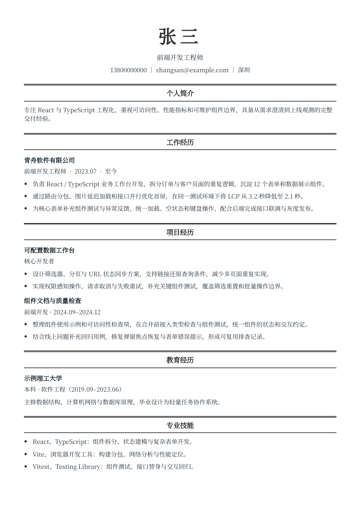</a> <b>书页宋体</b> 简约 · 经典</td><td align="center" width="25%"><a href="./templates/atlas-centered-rule/README.md">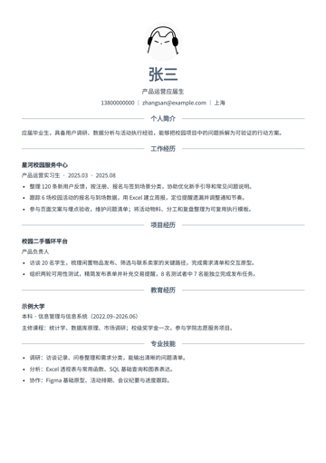</a> <b>中轴横线</b> 简约 · 经典</td><td align="center" width="25%"><a href="./templates/atlas-framed-letter/README.md">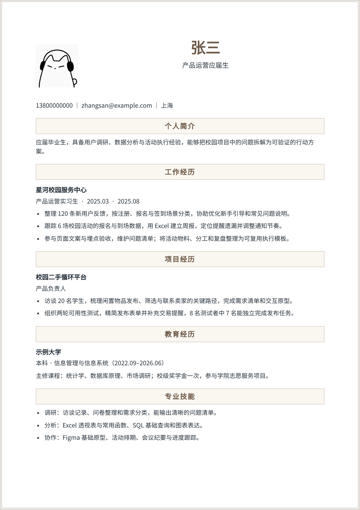</a> <b>信笺边框</b> 经典</td><td align="center" width="25%"><a href="./templates/atlas-numbered-sections/README.md">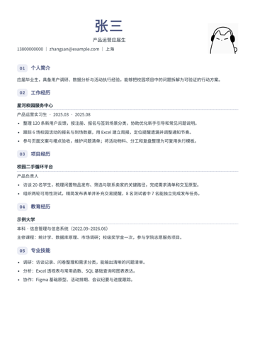</a> <b>数字章节</b> 现代</td></tr>
<tr><td align="center" width="25%"><a href="./templates/atlas-ivory-sidebar/README.md">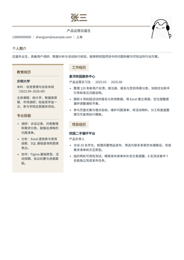</a> <b>米白档案</b> 简约 · 现代</td><td align="center" width="25%"><a href="./templates/atlas-sand-sidebar/README.md">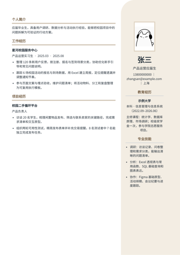</a> <b>沙丘边栏</b> 简约 · 现代</td><td align="center" width="25%"><a href="./templates/atlas-split-panel/README.md">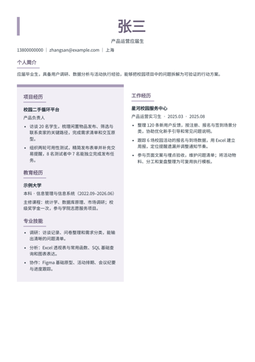</a> <b>左右拼版</b> 现代 · 创意</td><td align="center" width="25%"><a href="./templates/atlas-capsule-head/README.md">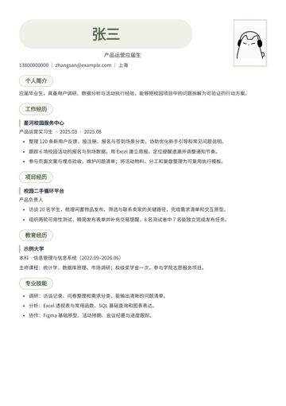</a> <b>胶囊页眉</b> 现代 · 创意</td></tr>
<tr><td align="center" width="25%"><a href="./templates/atlas-arch-portrait/README.md">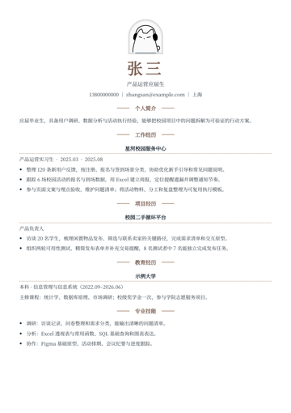</a> <b>拱形肖像</b> 经典 · 创意</td><td align="center" width="25%"><a href="./templates/career-spartan/README.md">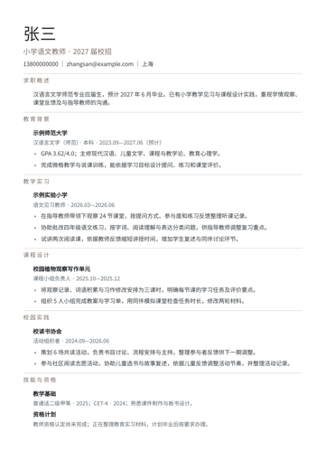</a> <b>留白师范履历</b> 简约</td><td align="center" width="25%"><a href="./templates/career-onepage/README.md">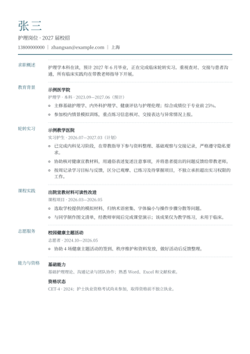</a> <b>细线护理履历</b> 简约 · 现代</td></tr>
</table>

### 实习简历模板（5 套）

在校生找实习，突出课程项目、社团和技能。

<table>
<tr><td align="center" width="25%"><a href="./templates/atlas-editorial-banner/README.md">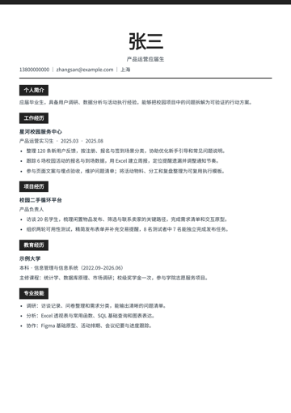</a> <b>编辑部头版</b> 现代 · 创意</td><td align="center" width="25%"><a href="./templates/atlas-forest-sidebar/README.md">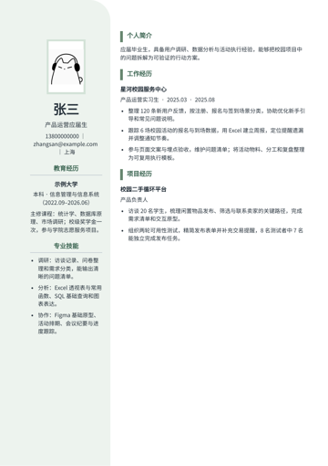</a> <b>林间分栏</b> 简约 · 现代</td><td align="center" width="25%"><a href="./templates/atlas-right-outline/README.md">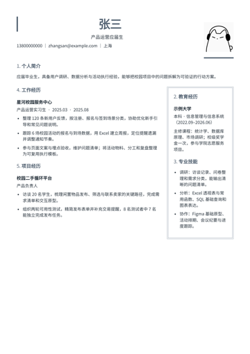</a> <b>右框履历</b> 经典 · 现代</td><td align="center" width="25%"><a href="./templates/atlas-right-cards/README.md">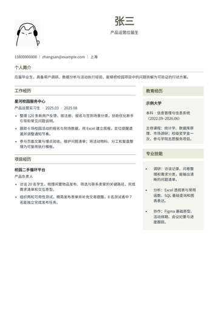</a> <b>右侧便笺</b> 现代</td></tr>
<tr><td align="center" width="25%"><a href="./templates/career-classic/README.md">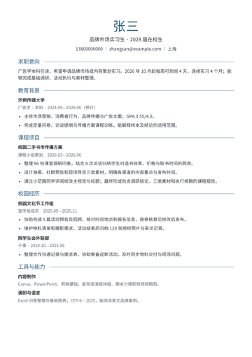</a> <b>蓝线传播履历</b> 简约 · 经典</td></tr>
</table>

### 社招简历模板（41 套）

有工作经验的跳槽求职，突出职责层级与业务成果。

<table>
<tr><td align="center" width="25%"><a href="./templates/atlas-mono-ledger/README.md">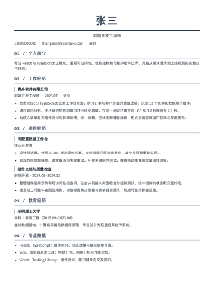</a> <b>技术账页</b> 简约 · 现代</td><td align="center" width="25%"><a href="./templates/atlas-corner-bracket/README.md">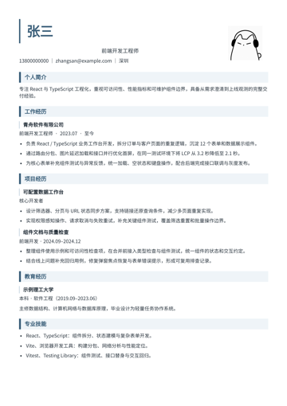</a> <b>折角索引</b> 现代 · 创意</td><td align="center" width="25%"><a href="./templates/atlas-split-nameplate/README.md">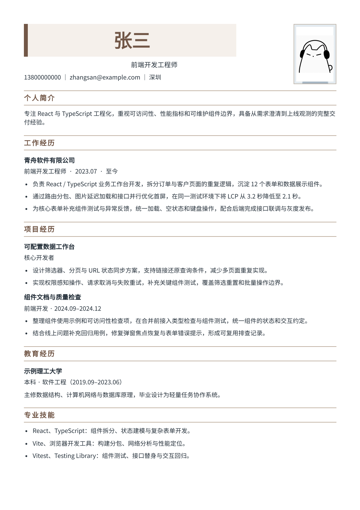</a> <b>姓名铭牌</b> 现代</td><td align="center" width="25%"><a href="./templates/atlas-underline-tabs/README.md">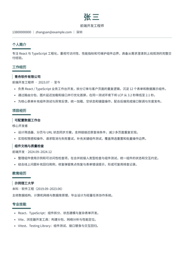</a> <b>下划标签</b> 简约 · 现代</td></tr>
<tr><td align="center" width="25%"><a href="./templates/atlas-dotted-journal/README.md">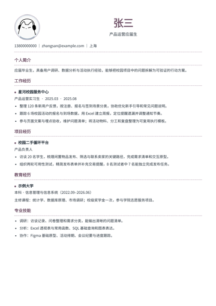</a> <b>点线手记</b> 简约 · 创意</td><td align="center" width="25%"><a href="./templates/atlas-ruled-notebook/README.md">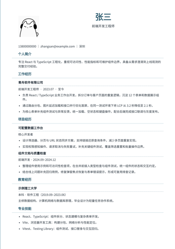</a> <b>线装笔记</b> 经典 · 创意</td><td align="center" width="25%"><a href="./templates/atlas-minimal-axis/README.md">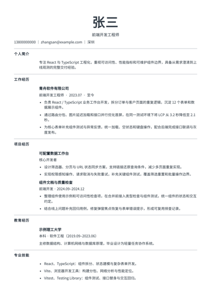</a> <b>极简坐标</b> 简约 · 现代</td><td align="center" width="25%"><a href="./templates/atlas-slate-sidebar/README.md">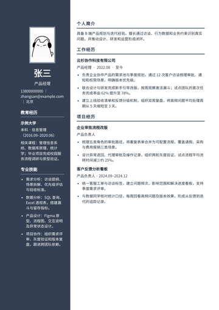</a> <b>石墨侧栏</b> 现代</td></tr>
<tr><td align="center" width="25%"><a href="./templates/atlas-portrait-rail/README.md">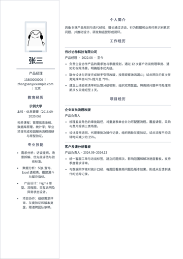</a> <b>肖像长廊</b> 现代</td><td align="center" width="25%"><a href="./templates/atlas-boxed-sidebar/README.md">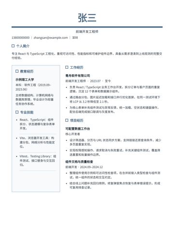</a> <b>方格资料</b> 现代</td><td align="center" width="25%"><a href="./templates/atlas-copper-sidebar/README.md">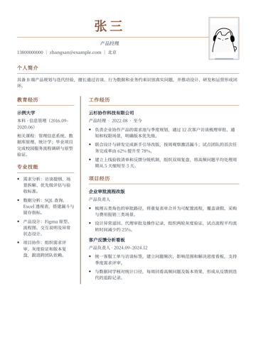</a> <b>铜线履历</b> 经典 · 现代</td><td align="center" width="25%"><a href="./templates/atlas-narrow-index/README.md">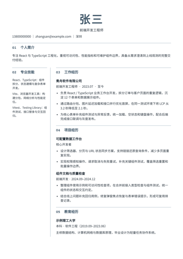</a> <b>窄栏索引</b> 简约 · 现代</td></tr>
<tr><td align="center" width="25%"><a href="./templates/atlas-ink-sidebar/README.md">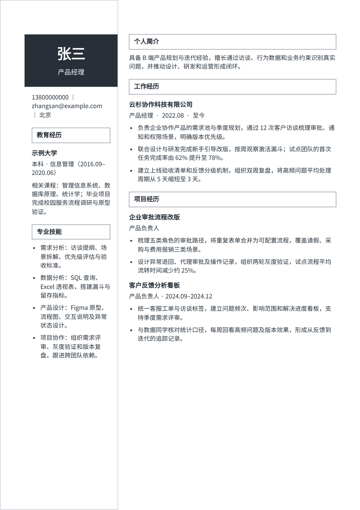</a> <b>墨色名片</b> 现代 · 创意</td><td align="center" width="25%"><a href="./templates/atlas-plum-sidebar/README.md">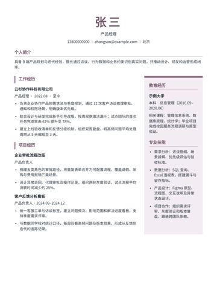</a> <b>梅影侧记</b> 现代</td><td align="center" width="25%"><a href="./templates/atlas-floating-profile/README.md">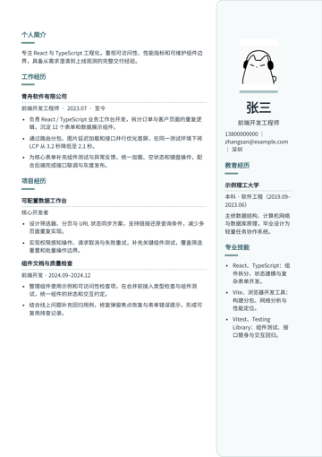</a> <b>悬浮名片</b> 现代 · 创意</td><td align="center" width="25%"><a href="./templates/atlas-teal-sidebar/README.md">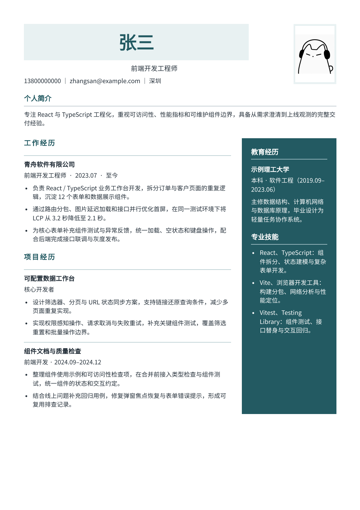</a> <b>青石分区</b> 现代</td></tr>
<tr><td align="center" width="25%"><a href="./templates/atlas-ribbon-profile/README.md">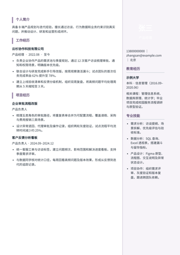</a> <b>纵向书签</b> 现代 · 创意</td><td align="center" width="25%"><a href="./templates/atlas-twin-ledger/README.md">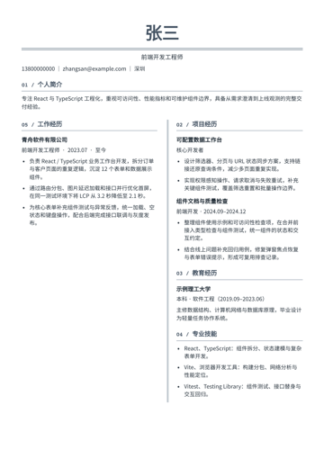</a> <b>双栏账册</b> 经典 · 现代</td><td align="center" width="25%"><a href="./templates/atlas-twin-cards/README.md">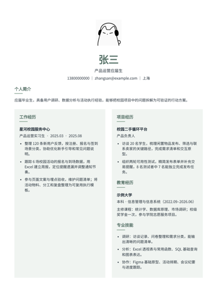</a> <b>双栏卡片</b> 现代</td><td align="center" width="25%"><a href="./templates/atlas-newspaper/README.md">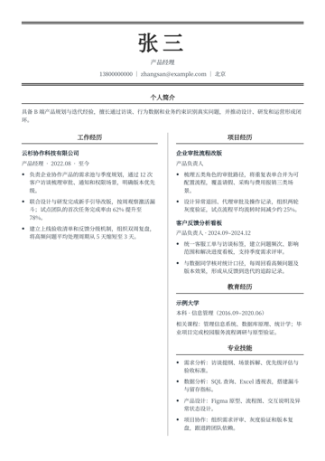</a> <b>报刊双栏</b> 经典 · 创意</td></tr>
<tr><td align="center" width="25%"><a href="./templates/atlas-crossbar/README.md">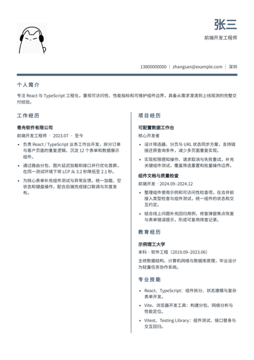</a> <b>十字分栏</b> 现代 · 创意</td><td align="center" width="25%"><a href="./templates/atlas-offset-masthead/README.md">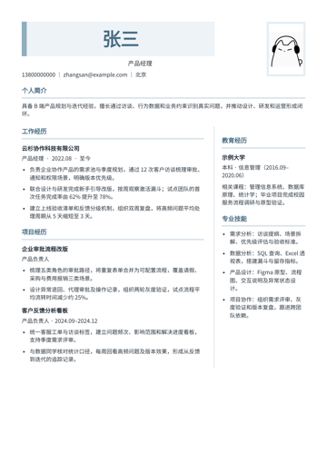</a> <b>错位刊头</b> 现代 · 创意</td><td align="center" width="25%"><a href="./templates/atlas-diagonal-head/README.md">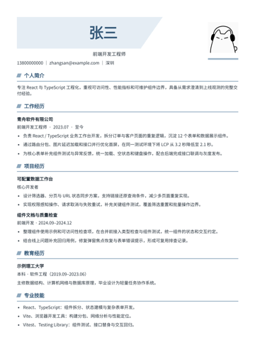</a> <b>斜切页眉</b> 现代 · 创意</td><td align="center" width="25%"><a href="./templates/atlas-top-bottom/README.md">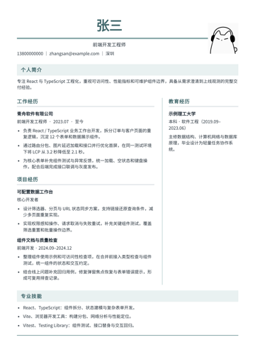</a> <b>页尾能力带</b> 现代</td></tr>
<tr><td align="center" width="25%"><a href="./templates/open-even/README.md">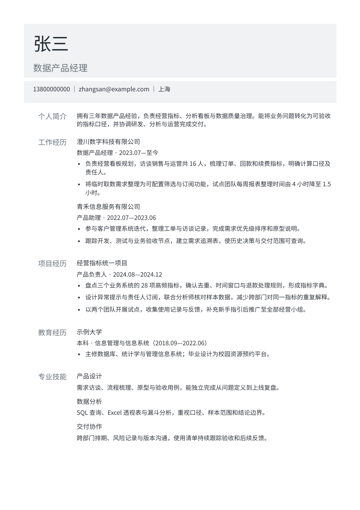</a> <b>灰阶章节索引</b> 简约 · 现代</td><td align="center" width="25%"><a href="./templates/open-moderncv/README.md">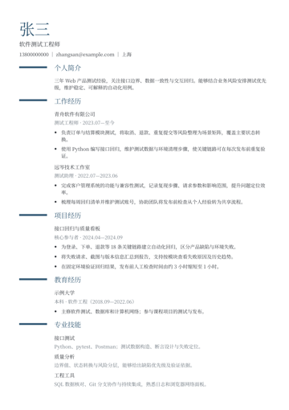</a> <b>学术短线履历</b> 简约 · 经典</td><td align="center" width="25%"><a href="./templates/open-caffeine/README.md">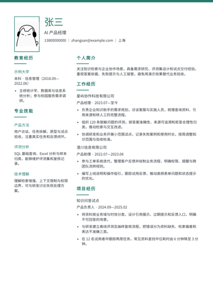</a> <b>青绿职业档案</b> 简约 · 现代</td><td align="center" width="25%"><a href="./templates/open-classy/README.md">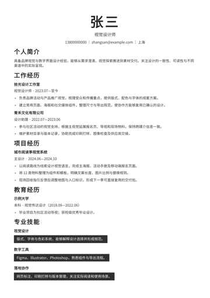</a> <b>黑白大字专栏</b> 经典 · 创意</td></tr>
<tr><td align="center" width="25%"><a href="./templates/open-actual/README.md">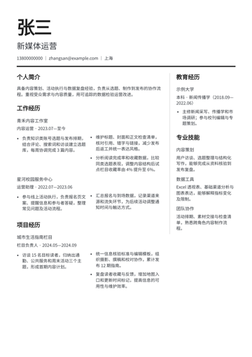</a> <b>编辑部双栏</b> 现代 · 创意</td><td align="center" width="25%"><a href="./templates/open-class/README.md">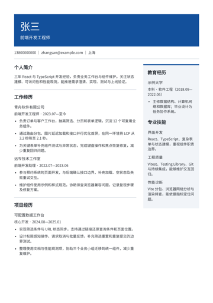</a> <b>蓝幕分区档案</b> 简约 · 现代</td><td align="center" width="25%"><a href="./templates/original-vermilion/README.md">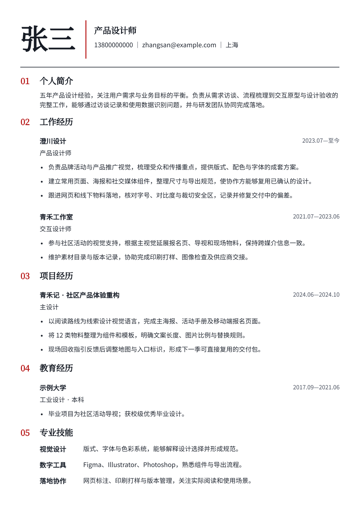</a> <b>朱砂编辑笺</b> 经典 · 创意</td><td align="center" width="25%"><a href="./templates/original-balanced/README.md">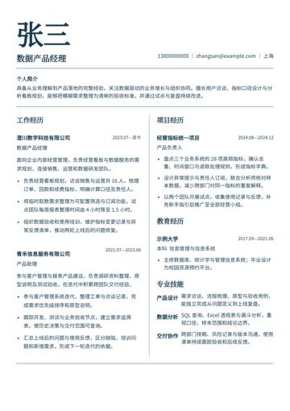</a> <b>横向分庭</b> 简约 · 现代</td></tr>
<tr><td align="center" width="25%"><a href="./templates/original-dossier/README.md">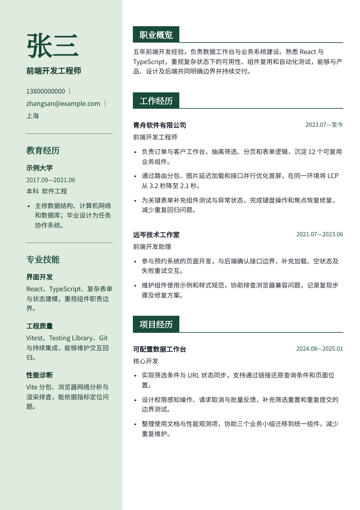</a> <b>墨绿档案签</b> 经典 · 现代</td><td align="center" width="25%"><a href="./templates/original-axis/README.md">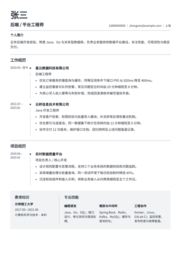</a> <b>横轴履历</b> 现代 · 创意</td><td align="center" width="25%"> <b>暖灰书页</b> 简约 · 经典</td><td align="center" width="25%"> <b>非对称索引</b> 现代 · 创意</td></tr>
<tr><td align="center" width="25%"> <b>错位页眉</b> 现代 · 创意</td><td align="center" width="25%"> <b>折页边注</b> 经典 · 创意</td><td align="center" width="25%"> <b>悬挂章节</b> 现代 · 创意</td><td align="center" width="25%"> <b>青墨财务档案</b> 经典</td></tr>
<tr><td align="center" width="25%"> <b>橙标精益履历</b> 现代</td></tr>
</table>

## 按岗位查找

每套模板的预览都配了一个示例岗位，方便你看到同类岗位的写法。版式本身不限岗位，可以套用任何经历。

| 岗位 | 模板 |
|---|---|
| 前端开发工程师简历模板 | [书页宋体](./templates/atlas-folio-serif/README.md)、[技术账页](./templates/atlas-mono-ledger/README.md)、[折角索引](./templates/atlas-corner-bracket/README.md)、[姓名铭牌](./templates/atlas-split-nameplate/README.md)、[下划标签](./templates/atlas-underline-tabs/README.md)、[线装笔记](./templates/atlas-ruled-notebook/README.md)、[极简坐标](./templates/atlas-minimal-axis/README.md)、[方格资料](./templates/atlas-boxed-sidebar/README.md)、[窄栏索引](./templates/atlas-narrow-index/README.md)、[悬浮名片](./templates/atlas-floating-profile/README.md)、[青石分区](./templates/atlas-teal-sidebar/README.md)、[双栏账册](./templates/atlas-twin-ledger/README.md)、[十字分栏](./templates/atlas-crossbar/README.md)、[斜切页眉](./templates/atlas-diagonal-head/README.md)、[页尾能力带](./templates/atlas-top-bottom/README.md)、[蓝幕分区档案](./templates/open-class/README.md)、[墨绿档案签](./templates/original-dossier/README.md) |
| 产品运营应届生简历模板 | [中轴横线](./templates/atlas-centered-rule/README.md)、[信笺边框](./templates/atlas-framed-letter/README.md)、[编辑部头版](./templates/atlas-editorial-banner/README.md)、[数字章节](./templates/atlas-numbered-sections/README.md)、[点线手记](./templates/atlas-dotted-journal/README.md)、[米白档案](./templates/atlas-ivory-sidebar/README.md)、[林间分栏](./templates/atlas-forest-sidebar/README.md)、[沙丘边栏](./templates/atlas-sand-sidebar/README.md)、[右框履历](./templates/atlas-right-outline/README.md)、[右侧便笺](./templates/atlas-right-cards/README.md)、[双栏卡片](./templates/atlas-twin-cards/README.md)、[左右拼版](./templates/atlas-split-panel/README.md)、[胶囊页眉](./templates/atlas-capsule-head/README.md)、[拱形肖像](./templates/atlas-arch-portrait/README.md) |
| 产品经理简历模板 | [石墨侧栏](./templates/atlas-slate-sidebar/README.md)、[肖像长廊](./templates/atlas-portrait-rail/README.md)、[铜线履历](./templates/atlas-copper-sidebar/README.md)、[墨色名片](./templates/atlas-ink-sidebar/README.md)、[梅影侧记](./templates/atlas-plum-sidebar/README.md)、[纵向书签](./templates/atlas-ribbon-profile/README.md)、[报刊双栏](./templates/atlas-newspaper/README.md)、[错位刊头](./templates/atlas-offset-masthead/README.md) |
| 后端 / 平台工程师简历模板 | [横轴履历](./templates/original-axis/README.md)、[暖灰书页](./templates/original-warm/README.md)、[非对称索引](./templates/original-index/README.md)、[错位页眉](./templates/original-offset/README.md)、[折页边注](./templates/original-marginal/README.md)、[悬挂章节](./templates/original-hanging/README.md) |
| 数据产品经理简历模板 | [灰阶章节索引](./templates/open-even/README.md)、[横向分庭](./templates/original-balanced/README.md) |
| 软件测试工程师简历模板 | [学术短线履历](./templates/open-moderncv/README.md) |
| AI 产品经理简历模板 | [青绿职业档案](./templates/open-caffeine/README.md) |
| 视觉设计师简历模板 | [黑白大字专栏](./templates/open-classy/README.md) |
| 新媒体运营简历模板 | [编辑部双栏](./templates/open-actual/README.md) |
| 产品设计师简历模板 | [朱砂编辑笺](./templates/original-vermilion/README.md) |
| 财务分析师简历模板 | [青墨财务档案](./templates/career-kendall/README.md) |
| 生产工艺工程师简历模板 | [橙标精益履历](./templates/career-stack/README.md) |
| 小学语文教师简历模板 | [留白师范履历](./templates/career-spartan/README.md) |
| 护理岗位简历模板 | [细线护理履历](./templates/career-onepage/README.md) |
| 品牌市场实习生简历模板 | [蓝线传播履历](./templates/career-classic/README.md) |

## 示例数据

每个模板文件夹里有三个文件：

| 文件 | 内容 |
|---|---|
| `preview.png` | 完整 A4 预览图 |
| `thumbnail.png` | 缩略图 |
| `template.json` | 模板信息和完整示例简历 |

示例简历遵循 [`schema/canonical-resume.schema.json`](./schema/canonical-resume.schema.json)（JSON Schema Draft 2020-12），仓库里全部 57 份示例都通过了这个 schema 的校验。结构上是"身份信息 + 若干章节"，每个章节由条目（经历、项目、教育）和正文块（段落、列表）组成。

**示例内容均为虚构**：姓名统一为"张三"，手机号为占位号码 13800000000，邮箱使用 `example.com`，公司、项目和数据都是编出来的，只用于展示版式。

## 写简历的方法

模板解决的是"排得整齐"，内容怎么写可以参考同一团队的两个开源项目：

- [drawoffer-prompts](https://github.com/ql-link/drawoffer-prompts)：简历诊断、JD 匹配、STAR 改写等提示词，复制到任意 AI 助手即用。
- [drawoffer-skills](https://github.com/ql-link/drawoffer-skills)：同一套方法的 Claude Code Agent Skills。

## 许可证

[MIT](./LICENSE) © 2026 ql-link。可以自由使用、修改和分享这些模板与示例数据。

Career 系列和 Open 系列的排版改编自 MIT 授权的开源简历主题，原作者版权与许可声明见 [THIRD_PARTY_NOTICES.md](./THIRD_PARTY_NOTICES.md)。
