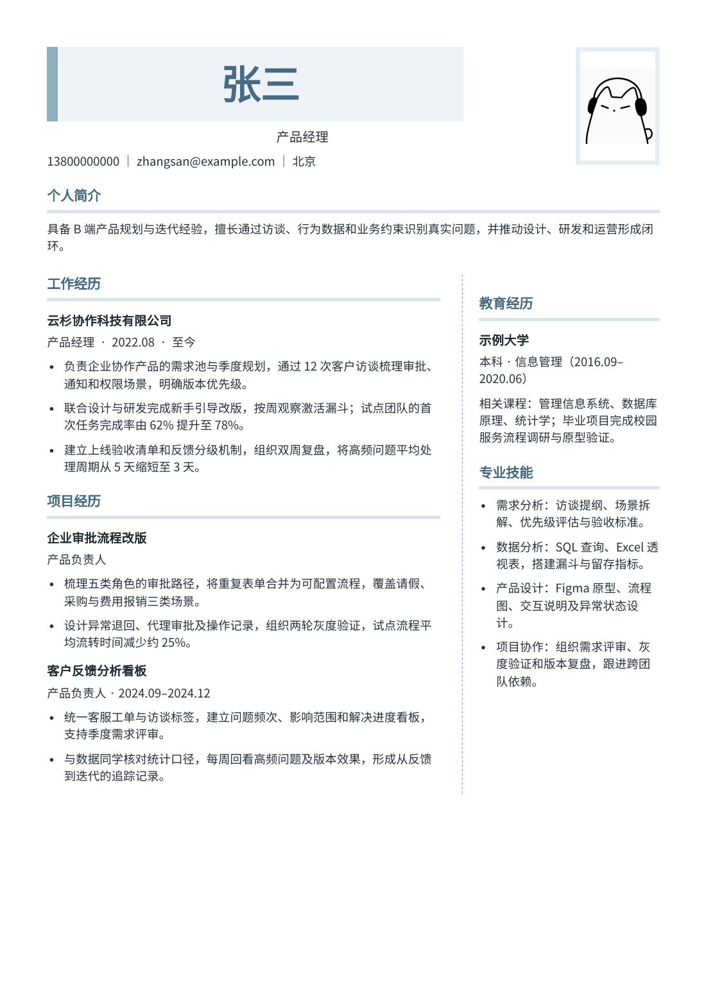

# 错位刊头 · 产品经理简历模板

> 左侧色条姓名与右侧圆头像、非对称双栏分区。

  

  

## 模板信息

| 属性 | 内容 |
|---|---|
| 系列 | Atlas 系列 |
| 风格 | 现代、创意 |
| 适用场景 | 社招 |
| 示例岗位 | 产品经理 |
| 示例模块 | 个人简介、工作经历、项目经历、教育经历、专业技能 |

## 怎么用

- **在线使用**：在 [DrawOffer 职绘](https://www.drawoffer.com/templates) 的模板库里选择「错位刊头」，可以直接编辑、导入已有简历，导出 A4 或智能一页 PDF。
- **拿示例数据**：[`template.json`](./template.json) 里是这份预览用的完整示例简历，结构见 [canonical-resume schema](../../schema/canonical-resume.schema.json)。

示例中的姓名、联系方式、公司和经历均为虚构，仅用于展示版式。

---

[← 返回全部模板](../../README.md)
