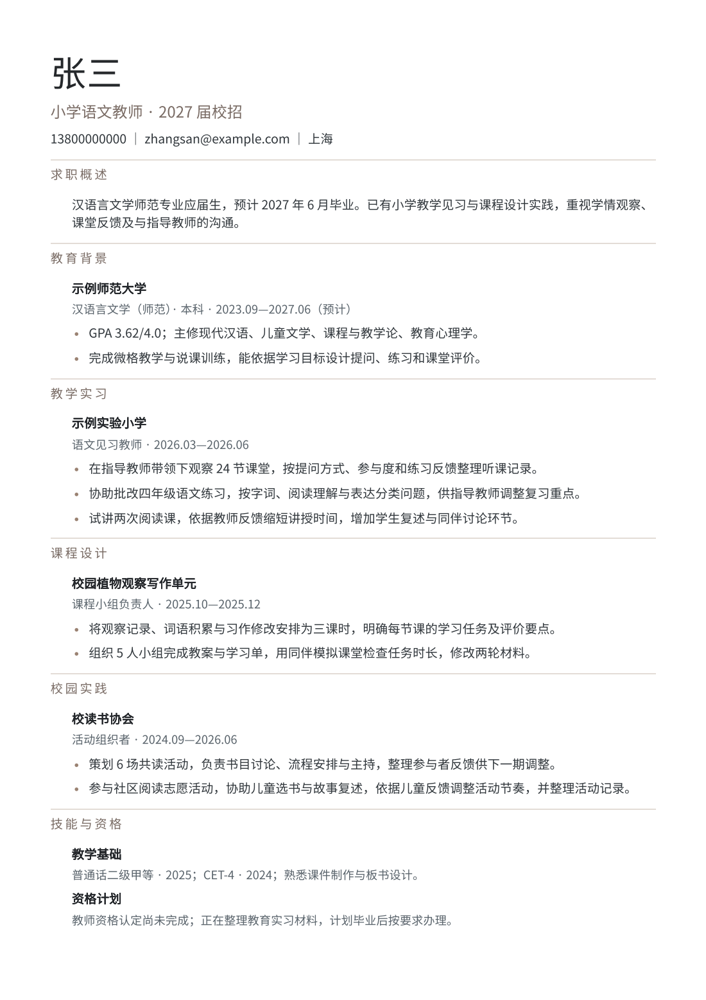

# 留白师范履历 · 小学语文教师简历模板

> Spartan 留白分区；师范校招示例，以教育、教学实习与校园实践为主。

  

  

## 模板信息

| 属性 | 内容 |
|---|---|
| 系列 | Career 系列 |
| 风格 | 简约 |
| 适用场景 | 校招 |
| 示例岗位 | 小学语文教师 |
| 示例模块 | 求职概述、教育背景、教学实习、课程设计、校园实践、技能与资格 |

## 怎么用

- **在线使用**：在 [DrawOffer 职绘](https://www.drawoffer.com/templates) 的模板库里选择「留白师范履历」，可以直接编辑、导入已有简历，导出 A4 或智能一页 PDF。
- **拿示例数据**：[`template.json`](./template.json) 里是这份预览用的完整示例简历，结构见 [canonical-resume schema](../../schema/canonical-resume.schema.json)。

示例中的姓名、联系方式、公司和经历均为虚构，仅用于展示版式。

---

[← 返回全部模板](../../README.md)
